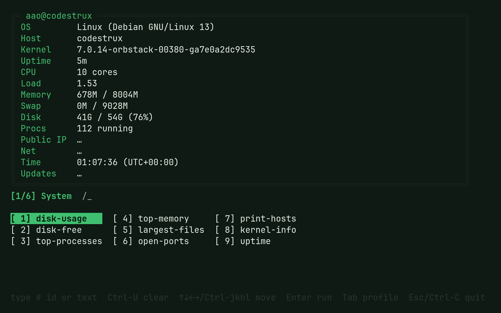
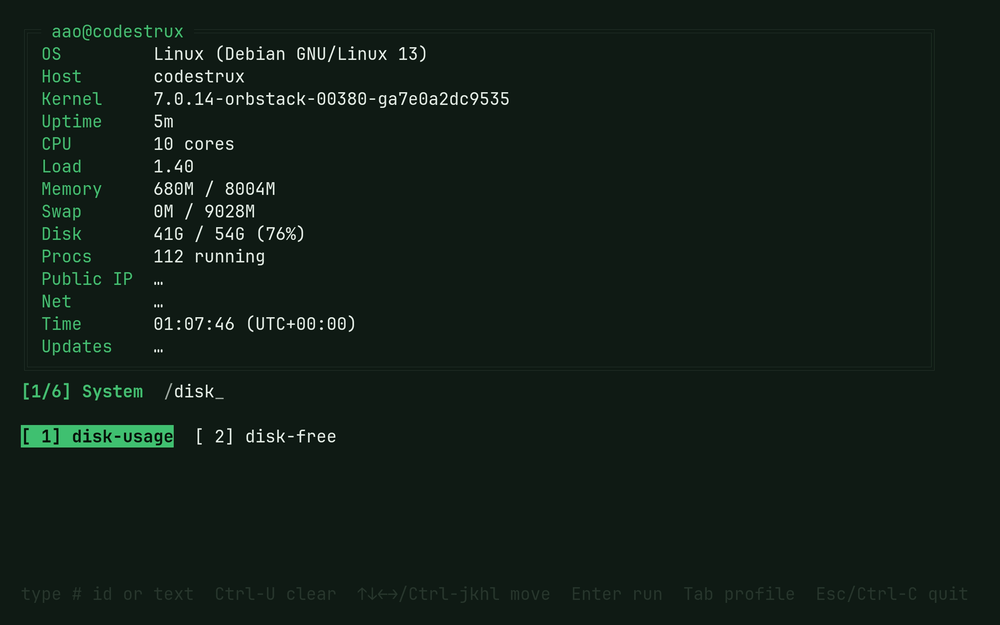
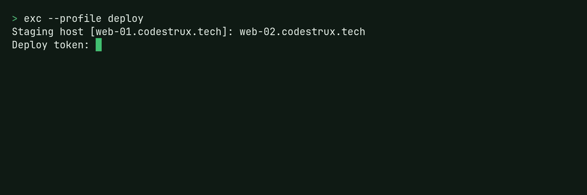
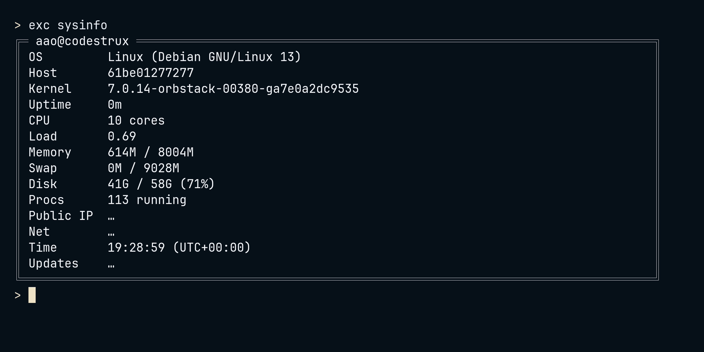

<section class="band band--hero">
  

    
exc · v0.9.1 · MIT

    <h1 class="hero__heading">El menú de todo para su terminal.</h1>
    
Un solo archivo TOML contiene sus comandos, perfiles y parámetros. exc los muestra en un selector con búsqueda que se maneja con el teclado, debajo de un encabezado con información del host en vivo. exc está escrito en Rust y se instala como un único binario llamado <code>exc</code>.

    

      <a class="btn btn--mono" href="https://crates.io/crates/exc-launcher" rel="noopener">cargo install exc-launcher</a>
      <a class="btn btn--ghost" href="https://github.com/codestrux/exc-launcher" rel="noopener">GitHub</a>
    

    <figure class="shot shot--hero">
      
      <figcaption>El selector: cuadrícula numerada, perfiles y encabezado del host</figcaption>
    </figure>
  

</section>

<section class="band band--alt">
  

    <figure class="shot">
      <video data-autoplay muted loop playsinline controls preload="metadata" poster="/assets/img/exc/demo-poster.png" width="2400" height="1500" aria-label="Demostración de exc: filtrar, navegar, responder un prompt de parámetro, ejecutar">
        <source src="/assets/img/exc/demo.webm" type="video/webm" />
        <source src="/assets/img/exc/demo.mp4" type="video/mp4" />
      </video>
      <figcaption>Filtro en vivo, salto por número, prompt de parámetro y ejecución</figcaption>
    </figure>
  

</section>

<section class="band">
  

    

      <article class="card">
        
$ exc

        <h3>El selector</h3>
        
Escriba para filtrar los comandos. El filtro es una expresión regular en vivo. Si la expresión no es válida, exc busca el texto. Los comandos están en una cuadrícula numerada, por columnas, como en <code>ls</code>. Escriba un número para ir a ese elemento. Mientras usted escribe un número, el símbolo del prompt cambia a <code>#</code>.

        <ul aria-label="Teclas del selector">
          <li><kbd>Enter</kbd> ejecuta el comando. <kbd>Esc</kbd> sale.</li>
          <li><kbd>Tab</kbd> y <kbd>Shift-Tab</kbd> cambian de perfil.</li>
          <li><kbd>Ctrl-H</kbd> <kbd>Ctrl-J</kbd> <kbd>Ctrl-K</kbd> <kbd>Ctrl-L</kbd> mueven la selección, como en vim. Las letras sin <kbd>Ctrl</kbd> van al filtro, como en fzf.</li>
        </ul>
        <figure class="shot">
          
          <figcaption>Filtro con una expresión regular</figcaption>
        </figure>
      </article>
      <article class="card">
        
$ exc init

        <h3>Configuración y parámetros</h3>
        
Toda la configuración está en <code>~/.config/exc/config.toml</code>. Los perfiles agrupan los comandos. Un marcador <code>{{param}}</code> hace que exc pida un valor cuando el comando se ejecuta. Un parámetro puede tener un valor por defecto. Con <code>secret = true</code>, exc oculta la entrada. Los comandos se ejecutan por medio de <code>sh -c</code> con la terminal conectada, así que ssh, fzf y sudo funcionan bien. Para cargar la configuración de un proyecto, use <code>--config</code>.

        <pre><code>[[profiles]]
        name = "network"
        label = "Network"

          [[profiles.commands]]
          name = "cert-check"
          description = "Check the TLS certificate for a domain"
          command = "openssl s_client -connect {{domain}}:443"

        [[profiles.commands.params]]
        name = "domain"
        prompt = "Domain to check"
        secret = false</code></pre>
        <figure class="shot">
          
          <figcaption>Prompt de parámetro. Con secret = true, exc oculta la entrada.</figcaption>
        </figure>
      </article>
    

  

</section>

<section class="band band--alt">
  

    

      <article class="card">
        
$ exc sysinfo

        <h3>Panel de información del sistema</h3>
        
El panel del host lee los datos en tres grupos.

        <ul>
          <li><strong>Al arrancar:</strong> los datos que se leen rápido. Son el sistema operativo, el kernel, el tiempo de actividad, la memoria, el disco, la CPU, la carga, la dirección IP local, la batería, los procesos principales y la GPU.</li>
          <li><strong>En segundo plano:</strong> los datos que se leen lento. Son la dirección IP pública, las actualizaciones de paquetes y el tráfico de red. El panel muestra esos datos cuando llegan y no se bloquea.</li>
          <li><strong>API nativas de cada plataforma:</strong> sysctl e IOKit en macOS, /proc y /sys en Linux, kernel32 y PowerShell CIM en Windows.</li>
        </ul>
        <figure class="shot">
          
          <figcaption>El panel sysinfo</figcaption>
        </figure>
      </article>
      <article class="card">
        
$ grep -rl unsafe src/

        <h3>Rust seguro</h3>
        <pre><code>src/hostinfo/platform/macos.rs
        src/hostinfo/platform/linux.rs
        src/hostinfo/platform/windows.rs
        src/hostinfo/platform/macos/iokit_ffi.rs</code></pre>
        
Esa es la lista completa de archivos con código <code>unsafe</code>. El selector, el ejecutor, la configuración y los temas son Rust seguro. El compilador impide los errores de uso de memoria liberada (use-after-free), de doble liberación (double-free) y las condiciones de carrera de datos, y no hay recolector de basura. El código <code>unsafe</code> solo está en las llamadas al sistema operativo de la capa de información del host, donde la API del kernel lo hace necesario.

        
Si exc falla, un manejador de pánico restaura la terminal, así que una falla no puede bloquear su sesión. Los errores tienen tipos de thiserror.

        <ul class="tags" aria-label="Propiedades de seguridad">
          <li>núcleo en Rust seguro</li><li>unsafe solo en llamadas al sistema operativo</li><li>sin recolector de basura</li><li>terminal restaurada después de un pánico</li><li>thiserror</li>
        </ul>
      </article>
    

  

</section>

<section class="band">
  

    

      <article class="card">
        
$ theme nord

        <h3>Temas</h3>
        
exc tiene tres temas integrados: default, dark y mono. Usted también puede escribir una tabla <code>[theme]</code> en la configuración, o indicar un <code>theme_file</code>. exc incluye diez paletas. Un tema tiene seis campos: accent, border, text, muted, fondo de la selección y texto de la selección. exc respeta la variable <code>NO_COLOR</code>.

        <ul class="tags" aria-label="Paletas incluidas">
          <li>solarized-dark</li><li>solarized-light</li><li>dracula</li><li>nord</li><li>gruvbox-dark</li><li>one-dark</li><li>monokai</li><li>tomorrow-night</li><li>homebrew</li><li>ayu-dark</li>
        </ul>
      </article>
      <article class="card">
        
$ exc man

        <h3>Línea de comandos</h3>
        
<code>exc</code> sin argumentos abre el selector. <code>exc &lt;name&gt;</code> ejecuta el primer comando cuyo nombre contiene ese texto. <code>exc man</code> escribe la página man a partir de las mismas definiciones que <code>--help</code>, así que la página man siempre coincide con el binario.

        <ul aria-label="Subcomandos">
          <li><code>exc run</code> · <code>exc list</code> · <code>exc sysinfo</code></li>
          <li><code>exc validate --strict --format json</code></li>
          <li><code>exc init</code> · <code>exc man</code></li>
        </ul>
      </article>
    

  

</section>

<section class="band band--alt">
  

    
$ cargo install exc-launcher

    <h2>Instalar exc</h2>
    
exc necesita Rust 1.95 o más reciente (edición 2024). La licencia es MIT. Si la computadora no tiene las herramientas de Rust, use <code>launcher.sh</code> del repositorio. Es un script de bash sin dependencias. El archivo <code>EXAMPLES.md</code> tiene ejemplos de perfiles, parámetros y temas.

    
Autor: aao@codestrux.tech

    

      <a class="btn btn--mono" href="https://crates.io/crates/exc-launcher" rel="noopener">cargo install exc-launcher</a>
      <a class="btn btn--ghost" href="https://github.com/codestrux/exc-launcher" rel="noopener">GitHub</a>
      <a class="btn btn--ghost btn--mono" href="https://github.com/codestrux/exc-launcher/blob/main/EXAMPLES.md" rel="noopener">EXAMPLES.md</a>
    

  

</section>
