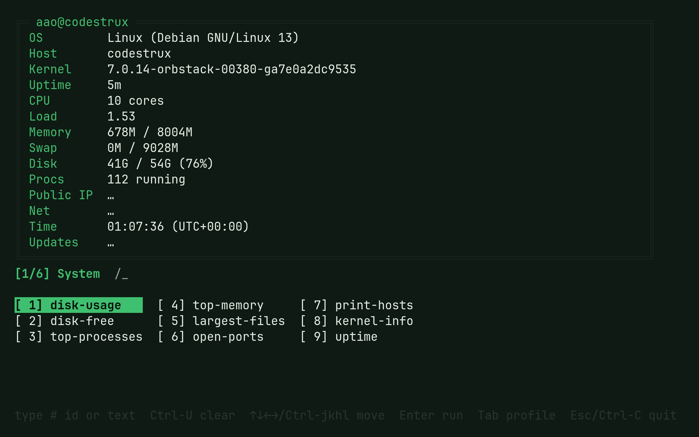
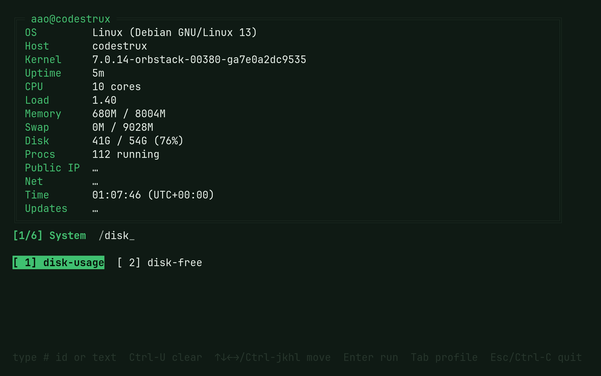
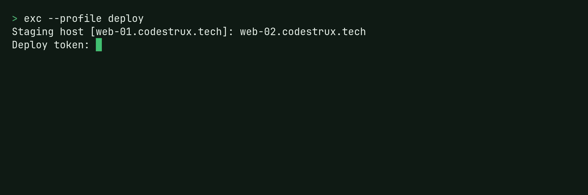
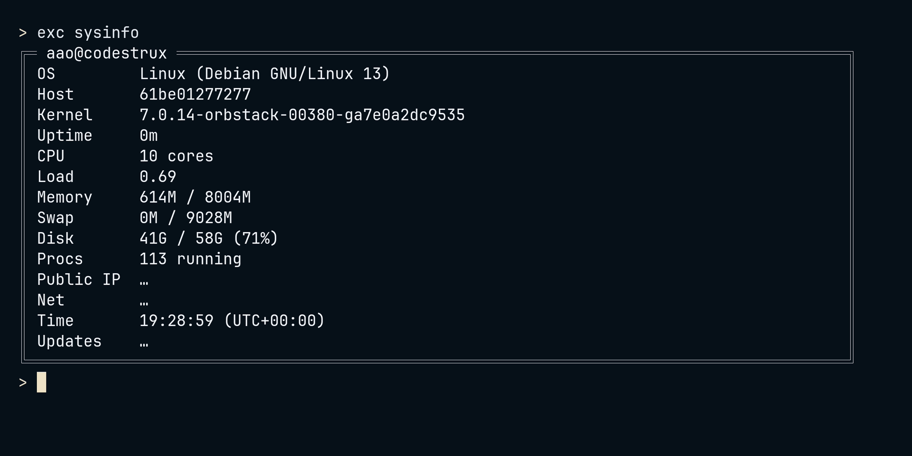

<section class="band band--hero">
  

    
exc · v0.9.1 · MIT

    <h1 class="hero__heading">The everything menu for your terminal.</h1>
    
One TOML file holds your commands, profiles, and parameters. exc shows them in a searchable picker that you drive with the keyboard, below a live host-info header. exc is written in Rust and installs as one binary named <code>exc</code>.

    

      <a class="btn btn--mono" href="https://crates.io/crates/exc-launcher" rel="noopener">cargo install exc-launcher</a>
      <a class="btn btn--ghost" href="https://github.com/codestrux/exc-launcher" rel="noopener">GitHub</a>
    

    <figure class="shot shot--hero">
      
      <figcaption>The picker: numbered grid, profiles, and host header</figcaption>
    </figure>
  

</section>

<section class="band band--alt">
  

    <figure class="shot">
      <video data-autoplay muted loop playsinline controls preload="metadata" poster="/assets/img/exc/demo-poster.png" width="2400" height="1500" aria-label="exc demo: filter, navigate, answer a parameter prompt, run">
        <source src="/assets/img/exc/demo.webm" type="video/webm" />
        <source src="/assets/img/exc/demo.mp4" type="video/mp4" />
      </video>
      <figcaption>Live filter, jump by number, parameter prompt, and run</figcaption>
    </figure>
  

</section>

<section class="band">
  

    

      <article class="card">
        
$ exc

        <h3>The picker</h3>
        
Type to filter the commands. The filter is a live regular expression. If the expression is not valid, exc searches for the text. The commands are in a numbered grid, in columns, as in <code>ls</code>. Type a number to go to that item. While you type a number, the prompt symbol changes to <code>#</code>.

        <ul aria-label="Picker keys">
          <li><kbd>Enter</kbd> runs the command. <kbd>Esc</kbd> quits.</li>
          <li><kbd>Tab</kbd> and <kbd>Shift-Tab</kbd> change the profile.</li>
          <li><kbd>Ctrl-H</kbd> <kbd>Ctrl-J</kbd> <kbd>Ctrl-K</kbd> <kbd>Ctrl-L</kbd> move the selection, as in vim. Letters without <kbd>Ctrl</kbd> go to the filter, as in fzf.</li>
        </ul>
        <figure class="shot">
          
          <figcaption>Filter with a regular expression</figcaption>
        </figure>
      </article>
      <article class="card">
        
$ exc init

        <h3>Configuration and parameters</h3>
        
All the configuration is in <code>~/.config/exc/config.toml</code>. Profiles group the commands. A <code>{{param}}</code> placeholder makes exc ask for a value when the command runs. A parameter can have a default value. With <code>secret = true</code>, exc hides the input. Commands run through <code>sh -c</code> with the terminal attached, so ssh, fzf, and sudo operate correctly. To load the configuration of a project, use <code>--config</code>.

        <pre><code>[[profiles]]
        name = "network"
        label = "Network"

          [[profiles.commands]]
          name = "cert-check"
          description = "Check the TLS certificate for a domain"
          command = "openssl s_client -connect {{domain}}:443"

        [[profiles.commands.params]]
        name = "domain"
        prompt = "Domain to check"
        secret = false</code></pre>
        <figure class="shot">
          
          <figcaption>Parameter prompt. With secret = true, exc hides the input.</figcaption>
        </figure>
      </article>
    

  

</section>

<section class="band band--alt">
  

    

      <article class="card">
        
$ exc sysinfo

        <h3>System info panel</h3>
        
The host panel reads data in three groups.

        <ul>
          <li><strong>At startup:</strong> data that is fast to read. This is the operating system, kernel, uptime, memory, disk, CPU, load, local IP address, battery, top processes, and GPU.</li>
          <li><strong>In the background:</strong> data that is slow to read. This is the public IP address, package updates, and network throughput. The panel shows this data when it arrives and does not block.</li>
          <li><strong>Native APIs for each platform:</strong> sysctl and IOKit on macOS, /proc and /sys on Linux, kernel32 and PowerShell CIM on Windows.</li>
        </ul>
        <figure class="shot">
          
          <figcaption>The sysinfo panel</figcaption>
        </figure>
      </article>
      <article class="card">
        
$ grep -rl unsafe src/

        <h3>Safe Rust</h3>
        <pre><code>src/hostinfo/platform/macos.rs
        src/hostinfo/platform/linux.rs
        src/hostinfo/platform/windows.rs
        src/hostinfo/platform/macos/iokit_ffi.rs</code></pre>
        
That is the full list of files with <code>unsafe</code> code. The picker, the executor, the configuration, and the themes are safe Rust. The compiler prevents use-after-free, double-free, and data races, and there is no garbage collector. <code>unsafe</code> code is only in the calls to the operating system in the host-info layer, where the API of the kernel makes it necessary.

        
If exc fails, a panic hook restores the terminal, so a failure cannot block your session. Errors have types from thiserror.

        <ul class="tags" aria-label="Safety properties">
          <li>safe-Rust core</li><li>unsafe only in OS calls</li><li>no garbage collector</li><li>terminal restored after a panic</li><li>thiserror</li>
        </ul>
      </article>
    

  

</section>

<section class="band">
  

    

      <article class="card">
        
$ theme nord

        <h3>Themes</h3>
        
exc has three built-in themes: default, dark, and mono. You can also write a <code>[theme]</code> table in the configuration, or point to a <code>theme_file</code>. Ten palettes come with exc. A theme has six fields: accent, border, text, muted, selected background, and selected foreground. exc obeys the <code>NO_COLOR</code> variable.

        <ul class="tags" aria-label="Bundled palettes">
          <li>solarized-dark</li><li>solarized-light</li><li>dracula</li><li>nord</li><li>gruvbox-dark</li><li>one-dark</li><li>monokai</li><li>tomorrow-night</li><li>homebrew</li><li>ayu-dark</li>
        </ul>
      </article>
      <article class="card">
        
$ exc man

        <h3>Command line</h3>
        
<code>exc</code> without arguments opens the picker. <code>exc &lt;name&gt;</code> runs the first command whose name contains that text. <code>exc man</code> writes the man page from the same definitions as <code>--help</code>, so the man page always agrees with the binary.

        <ul aria-label="Subcommands">
          <li><code>exc run</code> · <code>exc list</code> · <code>exc sysinfo</code></li>
          <li><code>exc validate --strict --format json</code></li>
          <li><code>exc init</code> · <code>exc man</code></li>
        </ul>
      </article>
    

  

</section>

<section class="band band--alt">
  

    
$ cargo install exc-launcher

    <h2>Install exc</h2>
    
exc needs Rust 1.95 or newer (edition 2024). The license is MIT. If the computer has no Rust toolchain, use <code>launcher.sh</code> from the repository. It is a bash script with no dependencies. The <code>EXAMPLES.md</code> file has examples of profiles, parameters, and themes.

    
Author: aao@codestrux.tech

    

      <a class="btn btn--mono" href="https://crates.io/crates/exc-launcher" rel="noopener">cargo install exc-launcher</a>
      <a class="btn btn--ghost" href="https://github.com/codestrux/exc-launcher" rel="noopener">GitHub</a>
      <a class="btn btn--ghost btn--mono" href="https://github.com/codestrux/exc-launcher/blob/main/EXAMPLES.md" rel="noopener">EXAMPLES.md</a>
    

  

</section>
